<div style="display: flex; align-items: center; gap: 20px;">
  
  <div>
    <h1 style="margin: 0;">Information technology and design patterns - Labs</h1>
    <p style="margin: 6px 0 0;">Created by: mgr inż. Bartłomiej Cis</p>
  </div>
</div>

# Class 1 — Introduction

Welcome to the Information technology and design patterns labs! These classes teach you how to use the right software architecture patterns when building applications. The intention is to give you an example of what the work of professional software engineers looks like on a daily basis. We'll go through the following scenario:

You are professional software engineers. AI adoption in the company is gaining momentum. More and more people use it to achieve goals that are outside their normal expertise — they build software! They vibe code.

The problem with vibe-coded apps is that they often don't follow code standards or good practices. As a result, they are not scalable or maintainable. They break at the first opportunity, and when that happens, the original creators come to you, the professional engineer. Your job is to fix the app and do it the right way. You know that an application should follow well-established code and architecture patterns. For you, it's a piece of cake, because you build great apps every day.

In these classes, your goal will be to refactor a simple app that is written as spaghetti code and, in each class, improve it by adding new software patterns. You'll learn:

- How to read and analyse a codebase
- How to plan and execute code refactors
- How particular design patterns work in real life
- How to safely refactor by relying on tests
- How to work both individually and in teams


## Patterns

Each picture below is the shared name and shape. The class that applies a pattern has the longer explanation: who calls whom, what each role is allowed to know, and what goes wrong when the pattern is used for the wrong job.

### Decorator

A decorator adds behavior around an object without changing that object's own code. The object and the decorator share the same interface, so a caller cannot tell them apart. Decorators can be stacked: each one does its extra work, then forwards the call.

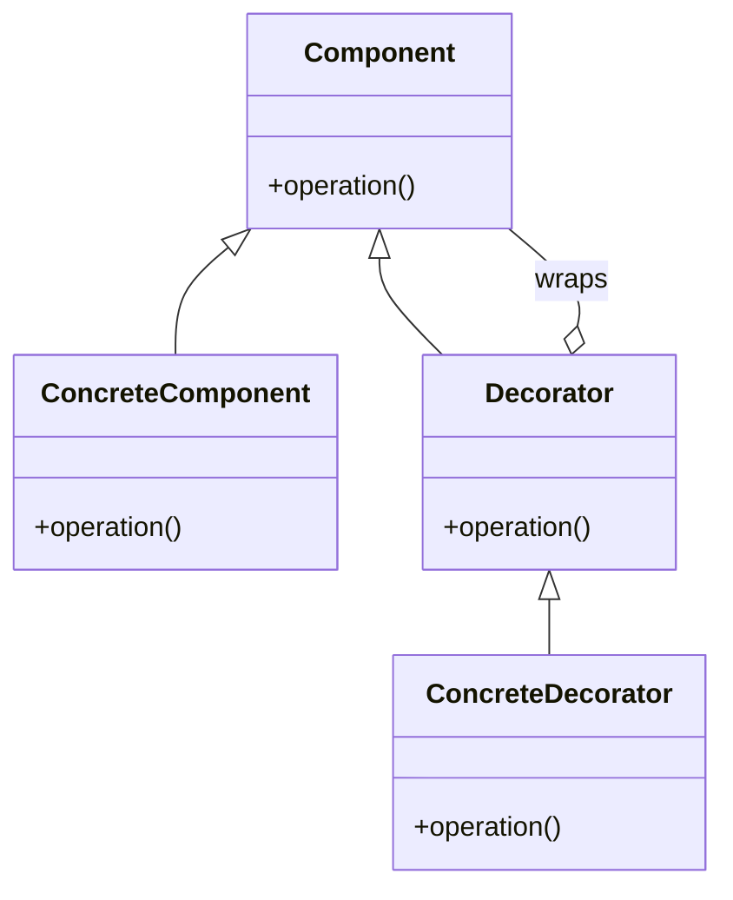

Class 2 uses this for the timing and request counter copied around every route.

### Factory Method

A factory method lets a creator decide which product to build, while the code that uses the product stays the same. The creator calls one method such as `create()`. A subclass, or another creator, returns the concrete record. Callers depend on the product interface, not on the constructor and the field list.

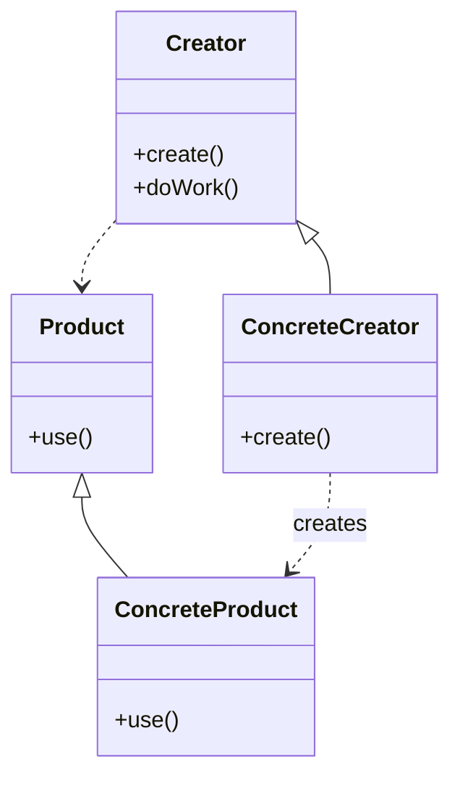

Class 3 uses this for log rows and for the two notice events.

### Builder

A builder assembles a complex result one part at a time, then returns the finished object. The director knows the order of steps. The builder knows how each step is stored. The same director can work with another builder when the steps stay the same and the representation changes.

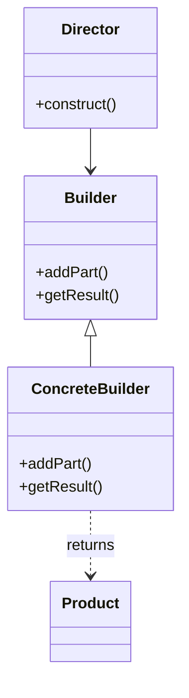

Class 3 uses this for one of the multi-field JSON responses, calories or daily targets.

### Singleton

A singleton guarantees that a class has one instance and that every caller reaches that same instance. The class hides the constructor and hands out the instance from one method. The cost is hidden shared state: tests, restarts, and a second caller all share whatever that instance remembers.

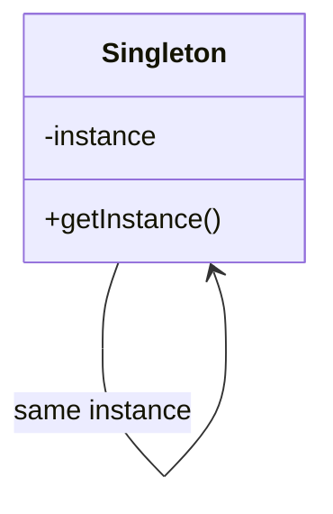

Class 3 discusses `REQUESTS` as this kind of shared object. The required work leaves it as a plain dictionary.

### Adapter

An adapter lets a client call an interface it already understands, while the real service offers a different one. The adapter translates the call, the arguments, and the result. The client never sees the service's own names or protocol.

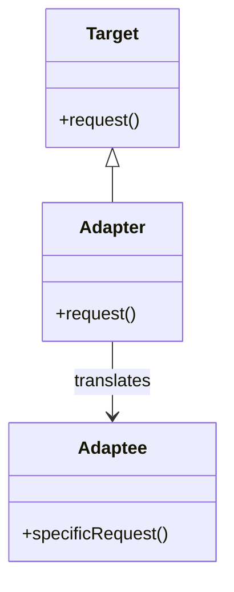

Class 4 uses this for the public macros service: lifestyle names and profile fields on this side, the remote query and JSON on the other.

### Facade

A facade is one object that offers a simple operation over several others. The caller asks for the outcome. The facade performs the steps and talks to the subsystem objects. Those objects can still be used directly when a caller needs a smaller step.

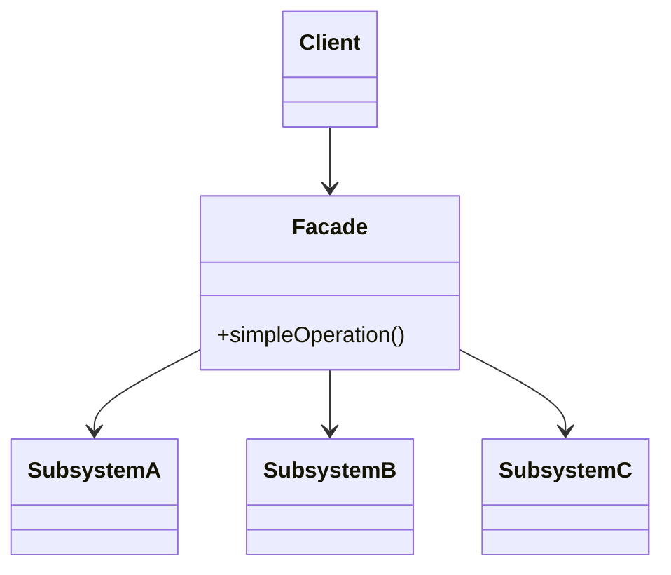

Class 4 uses this so `GET /targets` asks one object for daily targets, and that object reads the profile, sums the logs, chooses a lifestyle, and calls the adapter.

### Strategy

A strategy is a family of algorithms behind one interface. The context holds a strategy and asks it to do the step that varies. Replacing the strategy changes the algorithm. The context stays free of a long chain of special cases.

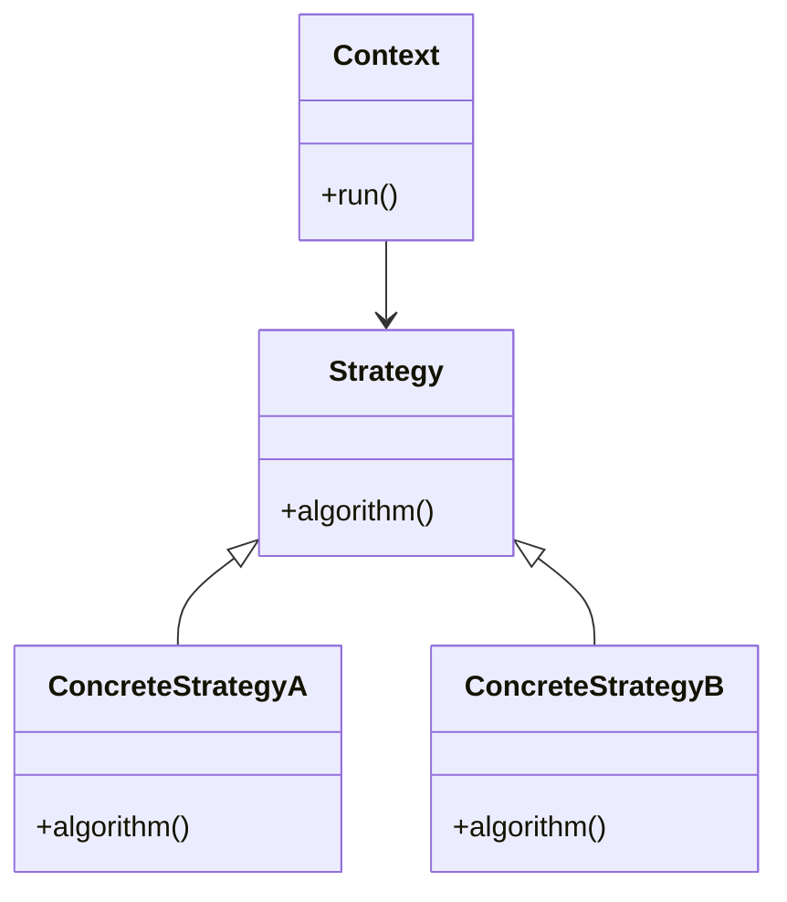

Class 5 uses this for day, week, and month: each strategy knows its time window and how to scale calories to a week.

### State

A state object represents one situation of a larger object and implements the behavior that is allowed in that situation. When something important happens, the object switches to another state. Callers send the same message either way. The current state decides what happens.

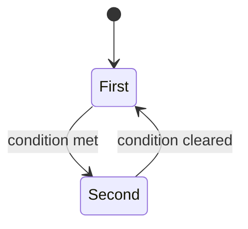

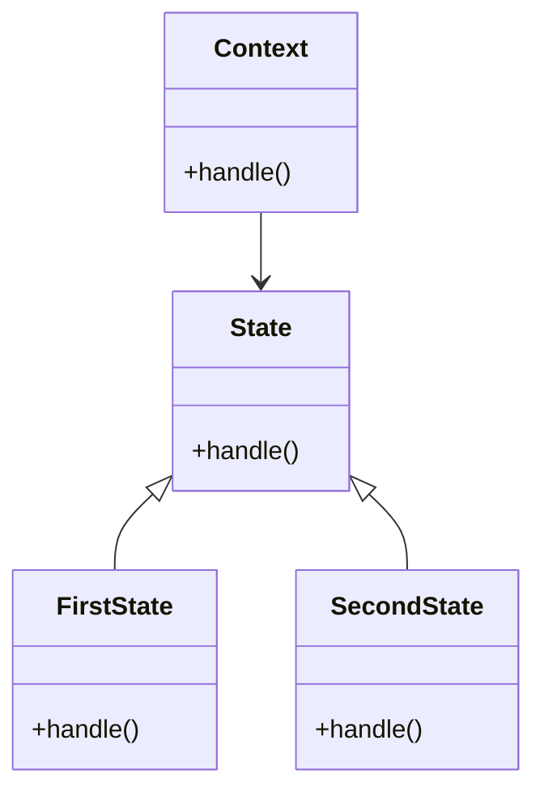

Class 5 uses this for the weekly exercise notice: under 500 kcal, or at and above it.

### Command

A command turns a request into an object. The object stores what to do and which receiver will do it. An invoker runs the command later, or runs it more than once, without knowing the receiver. Because the request is an object, it can also remember how to reverse itself.

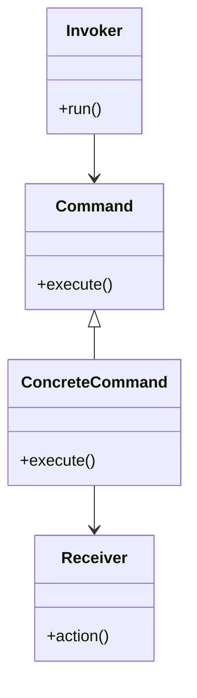

Class 5 uses this for logging a session and for undoing the last one.

### Observer

A subject keeps a list of observers and notifies them when something happens. Each observer reacts in its own way. The subject does not need a new branch for each new reaction. An observer can be added or removed without editing the subject.

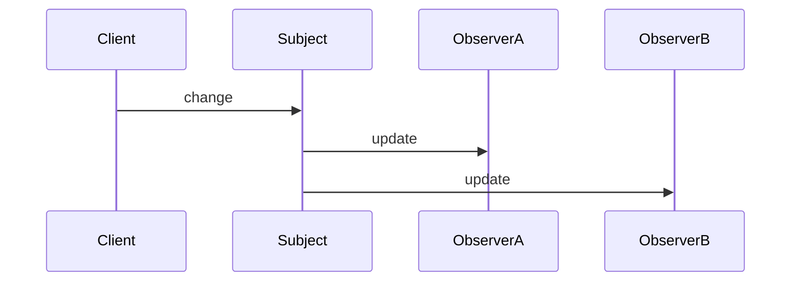

Class 6 uses this so a saved workout notifies listeners, and those listeners write the activity notice and the weekly-goal notice.

### Composite

A composite treats one object and a group of those objects the same way. A leaf does the work. A composite stores children and passes the same call down to each of them. Callers do not check whether they hold a leaf or a group.

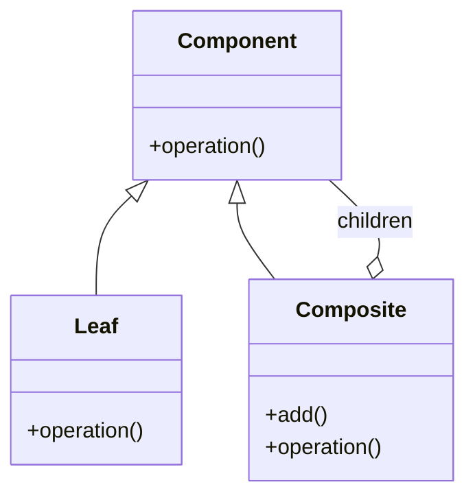

Class 6 decides whether the activity list needs this. It fits when a workout contains other workouts. A flat catalog of sports does not need it.

### Proxy

A proxy stands in for another object and uses the same interface. The caller talks to the proxy. The proxy decides when, and whether, to forward the call to the real object. Typical reasons are access control, a cache, or delaying a slow creation.

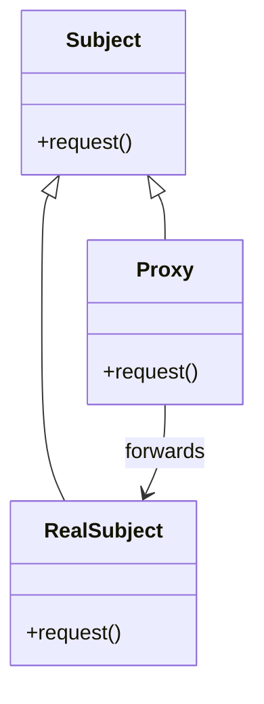

Class 6 decides whether the macros adapter needs a proxy, for example to remember a recent answer or to wait between calls to the public service.

## Your own copy

The shared repository is [cis-edu/architecure_design_patterns_python](https://github.com/cis-edu/architecure_design_patterns_python). You cannot push commits there. Each student works on a fork: a copy under their own GitHub account, with the same files and history.

1. Sign in to GitHub.
2. Open the repository link above and click **Fork**. Leave the fork name as `architecure_design_patterns_python` and create it under your user account.
3. Clone the fork, not the original. Replace `YOUR_USER` with your GitHub username:

```bash
git clone https://github.com/YOUR_USER/architecure_design_patterns_python.git
cd architecure_design_patterns_python
git remote -v
```

`origin` must point at `https://github.com/YOUR_USER/architecure_design_patterns_python.git`. Later classes push with `git push origin`. A push whose remote is `cis-edu` is rejected.

4. Follow **Setup** in the main README from this directory. The app should start, and `python -m unittest test_e2e.py -v` should pass.

Keep the fork up to date only when the teacher says the original has new commits:

```bash
git remote add upstream https://github.com/cis-edu/architecure_design_patterns_python.git
git fetch upstream
git merge upstream/main
```

Add `upstream` once. Do not push to it.

## In class

1. Read **What you can achieve** and call every example under **Requests**. For each call, write down what was saved and which file changed: `data/activities.json`, `data/logs.json`, `data/notices.json`, or `data/user.json`.
2. Trace one successful `POST /log` on paper or on the board. Include the catalog read, the calorie calculation, the log write, the weekly total, and the notices.
3. Trace `GET /targets` the same way. Include the saved profile, the burned calories, `LIFESTYLE_ACTIVITY`, `ACTIVITY_FOR_API`, and the HTTP call to the macros service.
4. Mark what is copied. The same request-timing block wraps every route. Opening a JSON file, the calorie formula, and the day/week/month windows each appear more than once.
5. Update the architecture diagram in the main README so it matches the code you actually read. The diagram is the one you will edit in later classes. Flowchart syntax is documented in the [Mermaid flowchart guide](https://mermaid.ai/open-source/syntax/flowchart.html).
6. Write down one behavior that looks wrong and one behavior that must stay. In particular, compare a normal week of exercise calories with the minimums in `LIFESTYLE_ACTIVITY`. Those minimums are total weekly energy, including rest. The logs are exercise only. A week of a few hundred calories stays `not active`, and the tests expect that.

## Leave the code as it is

Do not extract functions, rename routes, or introduce a pattern yet. The later classes each take one of the seams you marked.

## Done when

- You have a fork under your GitHub user, `origin` points at that fork, and the end-to-end test passes there.
- Every route has been called and its stored data named.
- The diagram matches the current handlers, files, and the macros call.
- The group can point at the copied timing block, the notices written inside `POST /log`, and the lifestyle comparison in `GET /targets`.

## Report

Write a PDF and upload it to the course section on the [WSEI e-learning platform](https://dl.wsei.pl/course/section.php?id=2220).

The PDF contains:

- Your name.
- A written explanation of what you did in this class.
- A screenshot of the architecture diagram in the main `README.md`, as it stands at the end of this class. The diagram is a Mermaid flowchart. Syntax is in the [Mermaid flowchart guide](https://mermaid.ai/open-source/syntax/flowchart.html).
- The link to your own repository with this class's commits pushed, for example `https://github.com/YOUR_USER/architecure_design_patterns_python`.
