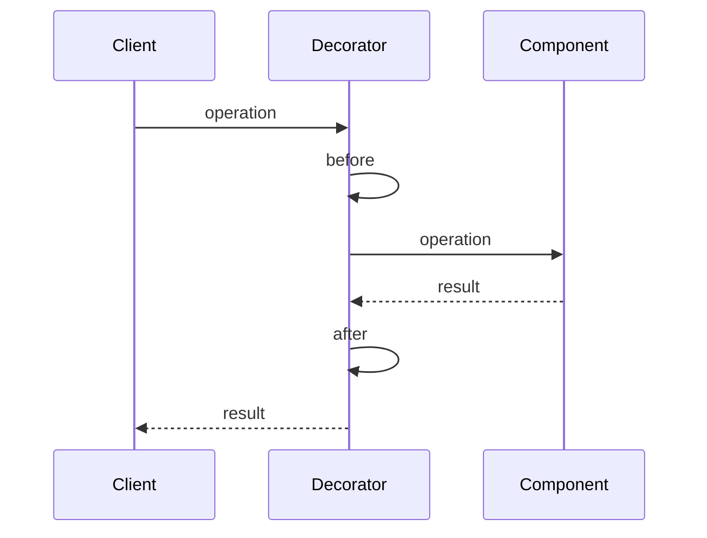

  
  

    <h1 style="margin: 0;">Information technology and design patterns - Labs</h1>
    
Created by: mgr inż. Bartłomiej Cis

  

# Class 2 — Decorator

Pattern this class: **Decorator**.

## Theory

A decorator adds a responsibility around an object that already does a job. The caller keeps using the same interface. The object that does the original job does not gain new branches for the extra responsibility. The decorator holds that object, does its own work before or after the call, and forwards the call.

Four roles appear in the usual description:

- **Component** is the interface the caller uses. In Python the interface is often just "a function that takes the request and returns a response".
- **Concrete component** is the original operation, here a route that validates input, touches files, and returns JSON.
- **Decorator** stores a component and implements the same interface. Its `operation` does the extra work and then calls the wrapped operation.
- **Concrete decorator** is one specific extra responsibility. Timing and the request counter are one concrete decorator. A second decorator, if you ever need one, would wrap the first and add a different responsibility, such as writing an access line.

The call the client makes is the call the component would have accepted. The decorator may measure that call, count it, or log it. Changing the status code, the JSON fields, or the files the component writes belongs to the component. A decorator that starts deciding those things has stopped being a wrapper and has become a second copy of the handler.

Stacking is the reason this is a pattern rather than one helper function called at the top of every route. Each wrapper has a single extra job. The route stays readable because the wrappers sit outside it. The order of the stack is part of the design: a counter that runs outside a timer counts the whole request, including the timer's own bookkeeping.

A Python function decorator is this pattern without a class. Writing `@timed` above a function replaces that function with a wrapper. The wrapper is the concrete decorator. The original function is the concrete component. `functools.wraps` copies the original name onto the wrapper so traces still show the route. A class with `__call__` is the same shape when the wrapper needs somewhere to keep the `REQUESTS` dictionary.

Subclassing every route to add timing would copy the timing into each subclass. The decorator composes the timing once and reuses it. That is the trade. You get another object on the call, and the object the framework calls is the wrapper, so the wrapper must accept the same arguments the route accepts.

## Further reading

- Ayeva, Kamon, and Sakis Kasampalis. *Mastering Python Design Patterns*, 3rd ed. Packt, 2024. [Publisher page](https://www.packtpub.com/en-us/product/mastering-python-design-patterns-9781837637652). Decorator is in Chapter 4, "The decorator pattern".
- [Decorator](https://refactoring.guru/design-patterns/decorator) on Refactoring.Guru, including the wrapper structure and how it differs from Adapter and Proxy.
- Python's own decorator syntax, which this class uses as the same idea without a class: the [glossary entry](https://docs.python.org/3/glossary.html#term-decorator), [PEP 318](https://peps.python.org/pep-0318/), and [`functools.wraps`](https://docs.python.org/3/library/functools.html#functools.wraps).

## Seam in this app

Each route repeats the same work around the real handler: increment `REQUESTS["count"]`, store `last_path`, time the call, store `last_seconds`, and print a line. That surrounding work is the decorator. The handler should keep the HTTP behavior it already has.

`log_activity` and `undo_log` show the shape. Some routes already call a helper (`_log_activity`, `_add_activity`, `_calories`, `_save_user`, `_daily_targets`). Others (`undo_log`, `list_notices`, `stats`, `list_activities`) keep the body in the same function as the timing. Make one decorator and use it on every route.

`GET /stats` reads `REQUESTS`. After this class, a call still increases `count` by one and reports `last_path`. `last_seconds` on the stats response is still the duration of the previous request, because the response is built before the `finally` block stores the new duration. Keep that order.

## Work

1. Run the end-to-end test and keep it as the check for the rest of the class.
2. Add a decorator that performs the timing and counter work, then calls the route function.
3. Remove the copied timing block from each route. A route function should read like the HTTP operation: validate input, touch the files, return JSON.
4. Update the architecture diagram. `REQUESTS` should hang off the decorator, once, rather than off every handler.
5. Say, in a few sentences, what the decorator is allowed to know. It may see the path and the clock. It should not decide calories, notices, or diet targets.

## Leave for later classes

- How log rows, notices, and activity rows are built (class 3).
- The urllib call and `GET /targets` (class 4).
- Day, week, and month windows, and undo (class 5).
- Writing notices from inside the log handler (class 6).

## Done when

- Every route uses the same decorator.
- `python -m unittest test_e2e.py -v` passes.
- The diagram shows one timing wrapper, not nine copies.

## Report

Write a PDF and upload it to the course section on the [WSEI e-learning platform](https://dl.wsei.pl/course/section.php?id=2220).

The PDF contains:

- Your name.
- A written explanation of what you did in this class.
- A screenshot of the architecture diagram in the main `README.md`, as it stands at the end of this class. The diagram is a Mermaid flowchart. Syntax is in the [Mermaid flowchart guide](https://mermaid.ai/open-source/syntax/flowchart.html).
- The link to your own repository with this class's commits pushed, for example `https://github.com/YOUR_USER/architecure_design_patterns_python`.
