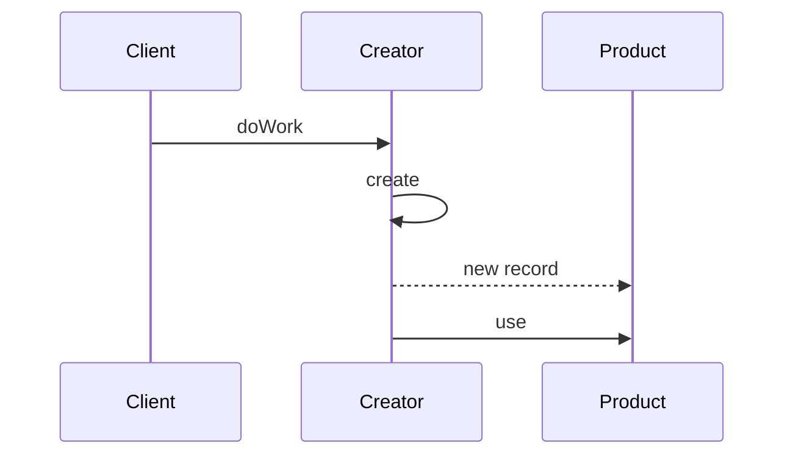
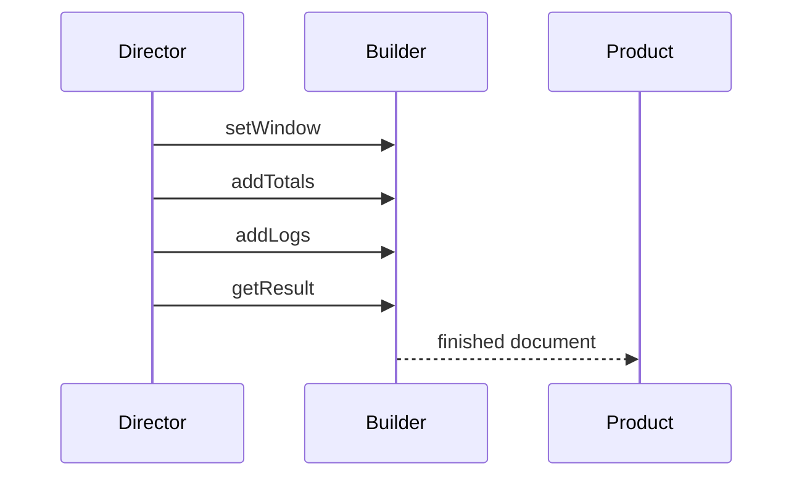
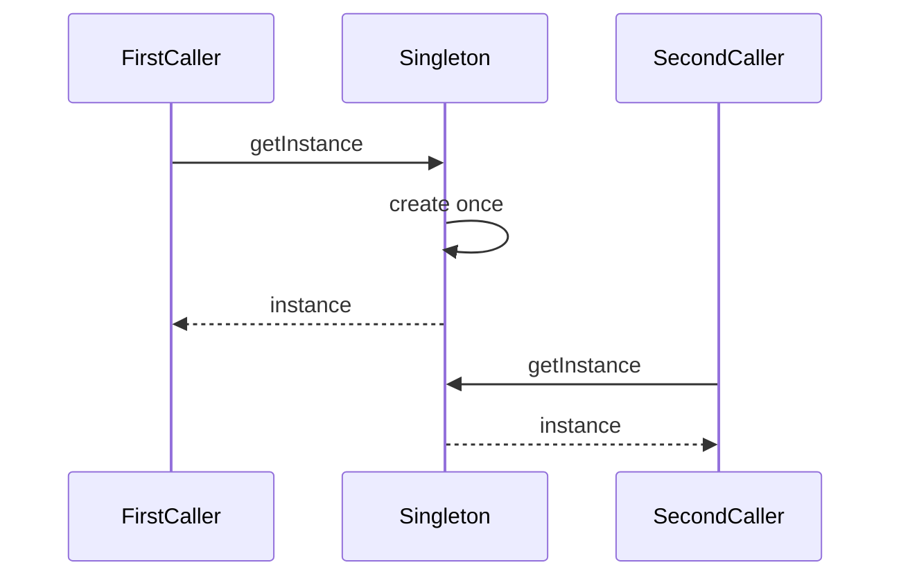

  
  

    <h1 style="margin: 0;">Information technology and design patterns - Labs</h1>
    
Created by: mgr inż. Bartłomiej Cis

  

# Class 3 — Factory Method and Builder

Patterns this class: **Factory Method** and **Builder**. Use **Singleton** only as a critique of `REQUESTS`. Do not add a Singleton class.

## Theory

### Factory Method

A factory method is a named way to create a product. The code that uses the product calls `create` and then works with the result. It does not call a constructor and it does not fill in the fields. A concrete creator decides which product comes back. Adding a new kind of product means adding a creator, or a branch inside one creator, in that one place.

The roles are:

- **Product** is the thing callers know how to use. For a log row, that is a record with `type`, `minutes`, and `logged_at`.
- **Concrete product** is one real record, such as an `activity_logged` notice or a `weekly_goal_reached` notice.
- **Creator** offers `create` and, often, a method that uses whatever `create` returned.
- **Concrete creator** implements `create` and returns one concrete product.

In Python, `create` can be a function that returns a dictionary. A class is useful when several creators share the surrounding steps and differ only in the record they build. The important part is the name and the single place that knows the keys. A function that still expects every caller to pass a half-built dictionary has not taken the construction away from those callers.

Factory Method returns a finished product in one call. Use it when the record has a stable shape and the caller already has the values that belong in it. Builder, below, is the other construction pattern in this class: the caller fills a result in steps because the parts arrive at different times.

### Builder

A builder separates the list of construction steps from the way the finished object is stored. A director knows the order: start, set the window, add the totals, attach the log list, return the result. A concrete builder knows what each step writes into the product. Another builder can store the same steps in a different shape, and the director stays as it is.

The roles are:

- **Director** runs the steps in order. It depends on the builder interface, not on dictionaries or JSON.
- **Builder** declares the steps and `getResult`.
- **Concrete builder** keeps the unfinished product and applies each step to it.
- **Product** is what `getResult` returns. Callers after that point see a finished document.

The director is optional. A caller may invoke the steps itself. What makes the object a builder is that construction is a sequence of parts, and the product is retrieved at the end. One method that takes every field and returns the document is a factory method. A user profile arrives as one query string and is checked as one set of fields, so a factory method fits that record better than a builder.

A builder holds an unfinished product. Reusing the same builder for a second document means resetting that product first, or creating a new builder. Forgetting the reset leaks fields from the previous response into the next one.

### Singleton

A singleton arranges that a class has one instance, and that every part of the program reaches that instance through one access point. The class hides creation. `getInstance` creates the object on the first call and returns that same object afterwards. The structure is a class with a reference to itself.

The instance is process-wide. It remembers data across requests. That is convenient for a counter and awkward for everything else that data affects. A test sees whatever an earlier test left behind. Restarting the process clears it, so the number was never durable. Code that calls `getInstance` cannot be pointed at a substitute without editing the class.

A class wrapped around a module-level dictionary does not remove those properties. The dictionary created at import, and closed over by the decorator from class 2, is already the single shared object. The critique in this class is to name that fact and leave the dictionary in place. One `data/user.json` is a product rule that this app stores one profile. The file is not a singleton type. Callers that read the file are not required to go through `getInstance`.

## Further reading

Ayeva, Kamon, and Sakis Kasampalis. *Mastering Python Design Patterns*, 3rd ed. Packt, 2024. [Publisher page](https://www.packtpub.com/en-us/product/mastering-python-design-patterns-9781837637652). Chapter 3 covers this class: "The factory pattern", "The builder pattern", and "The singleton pattern".

- [Factory Method](https://refactoring.guru/design-patterns/factory-method)
- [Builder](https://refactoring.guru/design-patterns/builder)
- [Singleton](https://refactoring.guru/design-patterns/singleton)

## Factory Method in this app

The app builds several kinds of records by hand, in the handler that happens to need them:

- a log row: `type`, `minutes`, `logged_at`
- a notice: `activity_logged` or `weekly_goal_reached`
- an activity row: `name`, `calories_per_60_min`
- a user profile from the query string

A factory method hides one of those shapes behind a named operation such as "make a log" or "make an activity-logged notice". Callers stop assembling the keys themselves. Start with log rows and the two notice events. They already have a stable shape that the tests check.

Keep the calorie formula next to the factory that needs it, or in one function the factory calls. `int(round(calories_per_60_min * minutes / 60))` is still the rule. Calories stay off the log row; they are calculated when a response or a notice needs them.

## Builder

`GET /calories` and `GET /targets` return documents with several fields (`period`, `from`, `to`, totals, the log list, and for targets the lifestyle and the remote daily targets). A builder is useful when the document is filled step by step: start it, set the window, add the totals, then the remote fields. Use a builder for one of those responses, not for both, unless the second one is clearly the same kind of assembly.

A user profile is a poor builder. Its fields all arrive in one query string and are checked together.

## Singleton, as a critique

`REQUESTS` is one module-level dictionary, created when the process starts and shared by every request. That is already a singleton. Discuss what that costs: the count disappears on restart, tests can see another test's calls, and the object cannot be replaced. Leave it as the dictionary the decorator from class 2 updates. A Singleton class would only rename that global.

The single `data/user.json` object is also one shared profile. That is a product choice (this app stores one user), not a reason to wrap the file in a Singleton.

## Work

1. Introduce a factory method for log rows and for each notice event. Handlers should call those methods.
2. Introduce a builder for either the calories response or the targets response.
3. Update the diagram with the factory and the builder.
4. Write a short note on why `REQUESTS` stays a plain dictionary.

## Done when

- New log and notice records are created in one place each.
- One response document is assembled by a builder.
- The end-to-end test passes, including notice events and undo leaving those notices in place.

## Report

Write a PDF and upload it to the course section on the [WSEI e-learning platform](https://dl.wsei.pl/course/section.php?id=2220).

The PDF contains:

- Your name.
- A written explanation of what you did in this class.
- A screenshot of the architecture diagram in the main `README.md`, as it stands at the end of this class. The diagram is a Mermaid flowchart. Syntax is in the [Mermaid flowchart guide](https://mermaid.ai/open-source/syntax/flowchart.html).
- The link to your own repository with this class's commits pushed, for example `https://github.com/YOUR_USER/architecure_design_patterns_python`.
