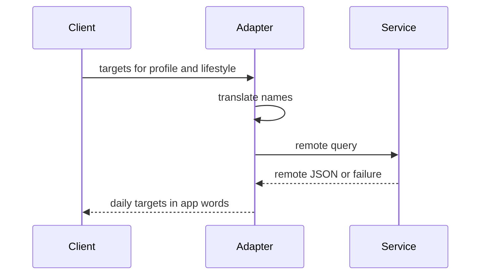
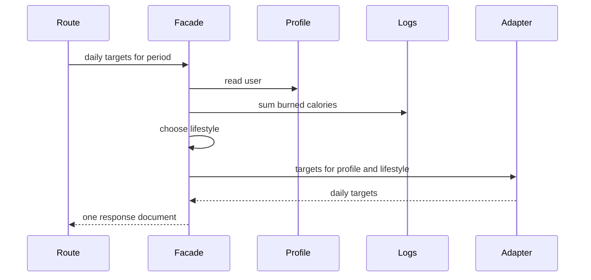

  
  

    <h1 style="margin: 0;">Information technology and design patterns - Labs</h1>
    
Created by: mgr inż. Bartłomiej Cis

  

# Class 4 — Adapter and Facade

Patterns this class: **Adapter** and **Facade**.

## Theory

### Adapter

An adapter makes one interface look like another. The client keeps calling the interface it was written for. The existing service keeps the interface it already has. The adapter sits between them and translates names, arguments, and results. This is an object adapter: the adapter holds the service and calls it. A class adapter would inherit from the service instead, which is a poor fit for a remote HTTP API the app does not own.

The roles are:

- **Target** is the interface the client wants. Here that is "given a profile and a lifestyle name, return daily targets", plus a failure the app can turn into a response.
- **Adaptee** is the existing service. Here it is the macros HTTP API: a URL, a query string, a required `User-Agent`, and a JSON body in the service's own shape.
- **Adapter** implements the target. It maps `not active` to `sedentary` and the other lifestyle names the same way, builds the request, calls the service, and maps a remote failure onto the app's error.
- **Client** is whoever needs daily targets. After this class, that client is the facade, not the route.

The adapter is allowed to know both vocabularies. The client is allowed to know only the app's words: lifestyle names such as `not active`, and fields such as `bmr`, `tdee`, and `daily_targets`. The host name and the query parameter `activity=sedentary` stay inside the adapter. When a second macros service appears, a second adapter implements the same target. The client does not grow a branch for each vendor.

Translation can include errors. A timeout or an unexpected body becomes the failure the target promised, which this app surfaces as HTTP 502. Swallowing that failure and returning zeros would hide a broken dependency inside a successful response.

An adapter that also reads the user file, sums logs, and chooses a lifestyle has taken on the facade's job. Keep the adapter to the boundary crossing.

### Facade

A facade gives one operation over a set of objects that would otherwise be called in order by the client. The client asks for the outcome. The facade knows which subsystem objects to call, and in which order. Those objects remain available for a caller that needs only one of the steps.

The roles are:

- **Facade** offers the coarse operation, such as "daily targets for this period".
- **Subsystem objects** do one step each: read the profile, sum burned calories, choose a lifestyle, ask the adapter for the remote numbers, assemble the document.
- **Client** is the route. It checks that the HTTP request is well formed enough to call the facade, then returns the facade's result.

A facade reduces how much the route has to know. It does not give the route permission to skip the rules. A missing profile, an unknown period, and a gender outside `male` or `female` are still failures the caller must see. The facade reports them. It does not replace them with a default user.

The risk is size. If every new rule is written directly inside the facade, the facade becomes the new long function. Its methods should call the subsystem objects, including the adapter and, in class 5, the period strategies. A small helper that only reads and writes a JSON file can sit behind the facade. That helper has no pattern name to defend. It reads bytes and returns a list or a dictionary.

Adapter and facade answer different questions. The adapter answers "how do I call this foreign thing in my own words?" The facade answers "which of my objects do I call, in what order, to finish this request?"

## Further reading

Ayeva, Kamon, and Sakis Kasampalis. *Mastering Python Design Patterns*, 3rd ed. Packt, 2024. [Publisher page](https://www.packtpub.com/en-us/product/mastering-python-design-patterns-9781837637652). Chapter 4 covers this class: "The adapter pattern" and "The facade pattern".

- [Adapter](https://refactoring.guru/design-patterns/adapter)
- [Facade](https://refactoring.guru/design-patterns/facade)

## Adapter in this app

`GET /targets` calls `https://calorieapiadmin.com/api/v1/public/calc/macros` with `urllib`, a `User-Agent` of `calorie-lab/1.0`, and query fields the remote service understands (`age`, `gender`, `weight_kg`, `height_cm`, `activity`, `goal`). The activity value is not the lifestyle name used in this app. `ACTIVITY_FOR_API` translates `not active` to `sedentary`, and the other four names the same way. A failure of that call becomes HTTP 502 with `could not load daily targets`.

An adapter is the object that speaks the macros service so the rest of the app can ask for daily targets in its own words: a profile and a lifestyle name in, and `bmr`, `tdee`, and `daily_targets` out. The host, the header, the name translation, and the 502 mapping stay inside the adapter.

Do not change the numbers the tests expect for a sedentary male profile (age 28, 80 kg, 178 cm, goal `maintain`): `bmr` 1778, `tdee` 2134, and the matching daily calories, protein, carbohydrates, and fat. The public service is rate limited. The test already waits between calls.

## Facade

After the adapter exists, `GET /targets` still does several jobs: read `data/user.json`, sum burned calories for the period, scale that sum to a week, choose a lifestyle, call the adapter, and return one JSON document. A facade offers one operation for that, such as "daily targets for this period", and the route becomes a thin call.

The route still returns 400 when the period is missing or unknown, when the profile is missing or invalid, and when `gender` is not `male` or `female`. The facade does not swallow those cases.

Reading and writing JSON files is copied in many handlers. You may group that behind a small file helper used by the facade and by the other routes. Keep that helper boring. It is not a second pattern.

## Work

1. Move the urllib call, the `User-Agent`, and `ACTIVITY_FOR_API` into an adapter.
2. Move the targets flow into a facade that uses the adapter.
3. Point the `GET /targets` route at the facade.
4. Update the diagram: handlers call the facade, and only the adapter calls the macros API.

## Done when

- No route function builds the macros URL.
- `GET /targets` still returns the sedentary numbers for a small training week and a higher activity level for a very large one, as the tests require.
- The end-to-end test passes.

## Report

Write a PDF and upload it to the course section on the [WSEI e-learning platform](https://dl.wsei.pl/course/section.php?id=2220).

The PDF contains:

- Your name.
- A written explanation of what you did in this class.
- A screenshot of the architecture diagram in the main `README.md`, as it stands at the end of this class. The diagram is a Mermaid flowchart. Syntax is in the [Mermaid flowchart guide](https://mermaid.ai/open-source/syntax/flowchart.html).
- The link to your own repository with this class's commits pushed, for example `https://github.com/YOUR_USER/architecure_design_patterns_python`.
