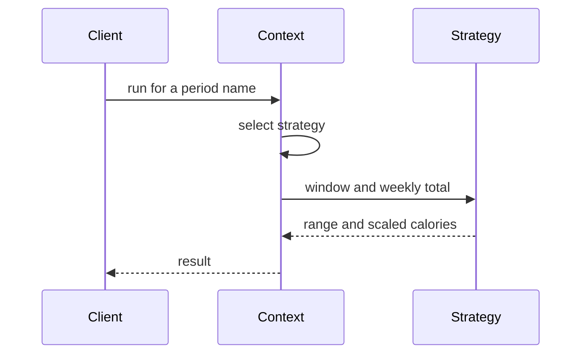
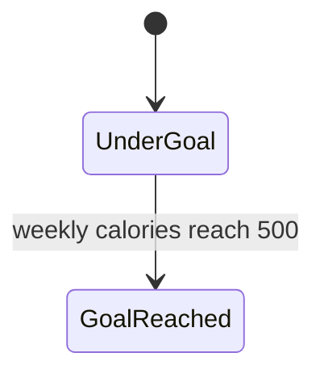
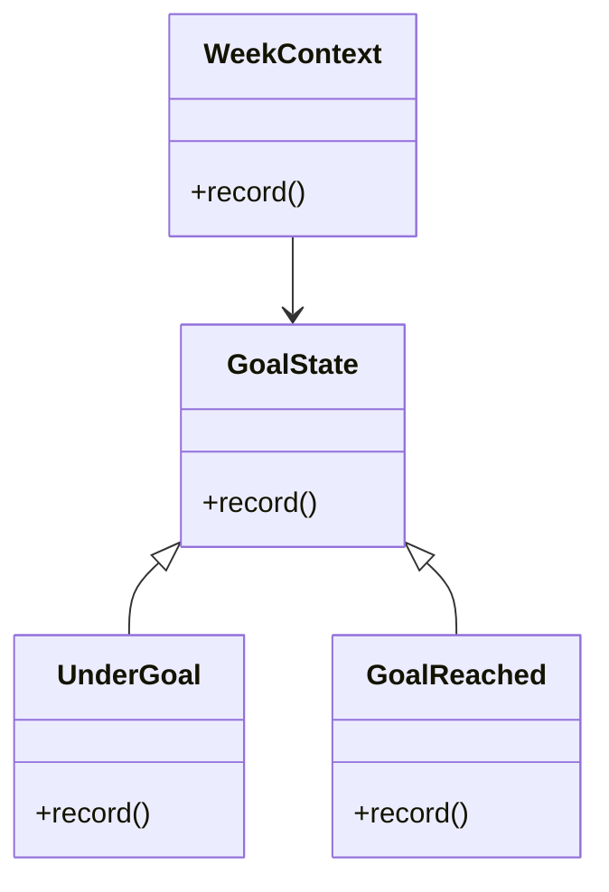
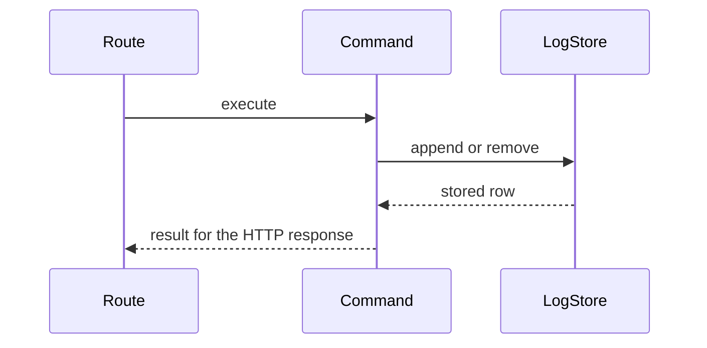

  
  

    <h1 style="margin: 0;">Information technology and design patterns - Labs</h1>
    
Created by: mgr inż. Bartłomiej Cis

  

# Class 5 — Strategy, State, and Command

Patterns this class: **Strategy**, **State**, and **Command**.

## Theory

### Strategy

A strategy replaces a choice of algorithm with an object. The context keeps a reference to a strategy and asks it to perform the step that varies. Each concrete strategy is one complete way to do that step. The context stops carrying a chain of `if period == "day"` branches. The caller selects the strategy from the request, usually once, and the strategy does not replace itself.

The roles are:

- **Context** is the object that has work to do and a hole where the varying part goes. Summing logs, or scaling a total to a week, is the context.
- **Strategy** is the interface: which logs fall inside the window, and how a total becomes a weekly figure.
- **Concrete strategies** are day, week, and month. Each one answers both questions for its own rule.

Day means the last 24 hours, and the weekly figure is that total times 7. Week means the last 7 days, unchanged. Month means the last 30 days, and the weekly figure is the total times 7/30, rounded. Those three rules are the algorithms. An unknown period is not a fourth strategy. It is a refusal to select one, and the route still answers HTTP 400.

`lose`, `maintain`, and `gain` travel to the macros service as data on the profile. They do not each implement an algorithm in this app. A strategy object would earn its place only if each goal calculated a different result locally.

Strategy and State, next, use the same drawing: a context and interchangeable objects. The difference is who chooses. The caller chooses a strategy and typically leaves it in place for that request. A state changes because something in the work itself crossed a line.

### State

A state object represents one situation, and the behavior that belongs to that situation. The context holds the current state and forwards the message to it. When the situation changes, the context holds a different state object. Callers keep sending the same message. The response changes because the state changed.

The roles are:

- **Context** is the week being judged against the exercise notice.
- **State** is the interface for "record this session's effect on the notice".
- **Concrete states** are under the goal, and at or past the goal. Under the goal, only the activity notice is produced. At or past the goal, the weekly-goal notice is produced as well.

The threshold stays 500 kcal of logged exercise. Reaching it is a transition from under-goal to goal-reached. Undo removes a log row and does not move the state back, because this app does not remove the notices already written. A state machine that "undid" the goal inside the undo command would invent a behavior the current tests reject.

Two states for one comparison can be heavier than a boolean. The pattern earns the extra type when each situation has its own behavior, not only its own label. If both states only return true or false and the caller still builds the notices, the state objects are decorative. The notice decision belongs in the state.

### Command

A command turns "do this" into an object with an `execute` method. The code that runs the command is the invoker. It does not know which files change. The command knows the receiver, which is the log store, and the arguments, which are the activity and the minutes, or the identity of the row to remove. Because the request is an object, it can keep the information needed to reverse itself.

The roles are:

- **Command** declares `execute`. A reverse method belongs on the commands whose effect this app is willing to undo.
- **Concrete command** is "append this log row" or "remove the last log row".
- **Invoker** is the route. It creates the command and calls `execute`.
- **Receiver** is the storage for `data/logs.json`. The command tells the receiver what to change.
- **Client** is the code that chooses which command to create. For these two routes, the client and the invoker are the same function.

The logging command stores the row it appended, which is enough to remove that row later. The undo command stores the row it removed, which is enough to put it back, if you implement that reverse. The notices written when a session is logged are outside this pair. An undo command that also deleted notices would cross the boundary the tests fix in place: after the running session is removed, the three notices are still there.

A command that opens every file the request touches, chooses notices, and calls the macros service is a procedure with `execute` written on it. Keep the log command on the log store. Other reactions to "a session was saved" are the observers in class 6.

## Further reading

Ayeva, Kamon, and Sakis Kasampalis. *Mastering Python Design Patterns*, 3rd ed. Packt, 2024. [Publisher page](https://www.packtpub.com/en-us/product/mastering-python-design-patterns-9781837637652). Chapter 5 covers this class: "The Command pattern", "The State pattern", and "The Strategy pattern".

- [Strategy](https://refactoring.guru/design-patterns/strategy)
- [State](https://refactoring.guru/design-patterns/state)
- [Command](https://refactoring.guru/design-patterns/command)

## Strategy in this app

Day, week, and month are three ways to answer the same question: which logs count, and how their calories scale to a week.

- A day is the last 24 hours, and the weekly figure is that total times 7.
- A week is the last 7 days, unchanged.
- A month is the last 30 days, and the weekly figure is `round(total * 7 / 30)`.

`GET /calories` and `GET /targets` both need the window. `POST /log` also walks the last 7 days for `weekly_calories`. Replace the copied `if period == ...` branches with three strategy objects that share one way to be asked for a window and a weekly total. Unknown or missing `period` is still HTTP 400.

The user's goal `lose`, `maintain`, or `gain` is a value sent to the macros service. It is not a strategy. Leave it as data on the profile.

## State

While logging, the week is either under the 500 kcal exercise notice or at and above it. Crossing the line adds a `weekly_goal_reached` notice as well as `activity_logged`. A state object can represent those two situations and decide whether the extra notice is produced. The threshold stays 500. Undo does not remove notices and does not move this state backwards.

Do not model the whole user as a state machine. Profile validation stays what it is.

## Command

`POST /log` and `POST /log/undo` are a pair. Logging appends one row to `data/logs.json`. Undo removes the last row and returns it, or returns 400 when the file is empty. Undo does not delete the notices that logging already wrote.

Turn each of those operations into a command with an execute step. Logging's command stores enough to remove the row it added. Undo's command stores enough to put that row back, if you implement the reverse. Calling undo from the route is executing the undo command, not a second copy of the file code.

Be honest in the class notes: the notice list is not part of the undo. A command that also deleted notices would fail the test, which expects the three notices to remain after the running session is removed.

## Work

1. Introduce day, week, and month strategies and use them from calories, targets, and the weekly total on log.
2. Represent under-goal and goal-reached as states used when notices are chosen.
3. Represent log and undo as commands.
4. Update the diagram.
5. Run the end-to-end test. Period totals, the 500 kcal goal, and undo's effect on logs and notices are the checks for this class.

## Done when

- The three periods each live in one strategy.
- Goal-reached behavior is chosen by a state, and the 500 kcal rule is unchanged.
- Log and undo go through commands, and undo still leaves notices in place.
- The end-to-end test passes.

## Report

Write a PDF and upload it to the course section on the [WSEI e-learning platform](https://dl.wsei.pl/course/section.php?id=2220).

The PDF contains:

- Your name.
- A written explanation of what you did in this class.
- A screenshot of the architecture diagram in the main `README.md`, as it stands at the end of this class. The diagram is a Mermaid flowchart. Syntax is in the [Mermaid flowchart guide](https://mermaid.ai/open-source/syntax/flowchart.html).
- The link to your own repository with this class's commits pushed, for example `https://github.com/YOUR_USER/architecure_design_patterns_python`.
