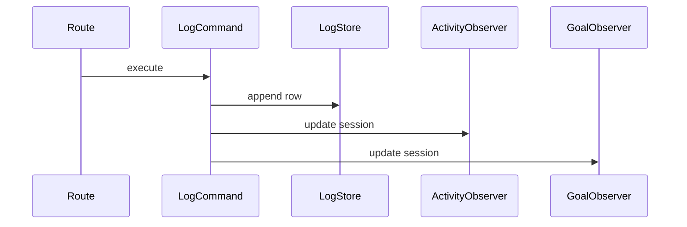
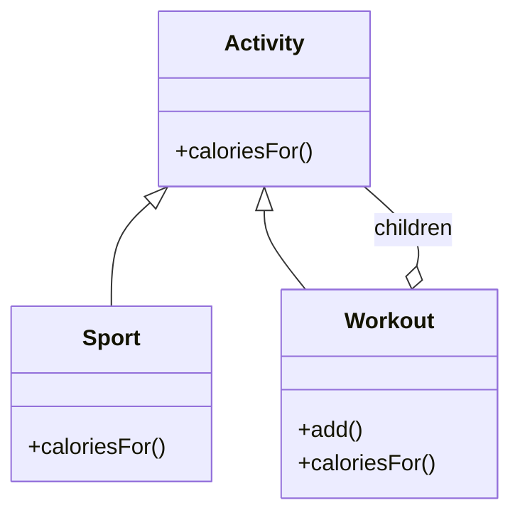
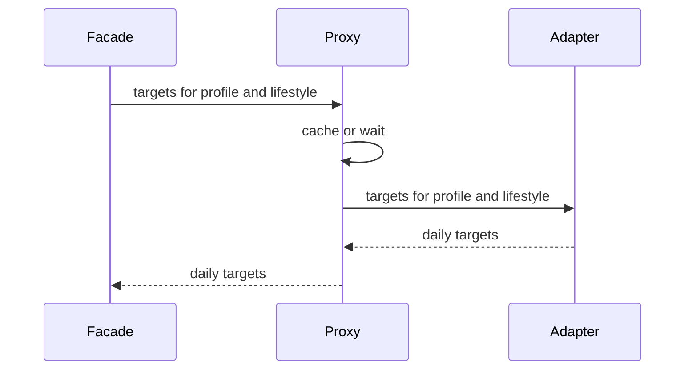

  
  

    <h1 style="margin: 0;">Information technology and design patterns - Labs</h1>
    
Created by: mgr inż. Bartłomiej Cis

  

# Class 6 — Observer

Pattern this class: **Observer**.

Composite and Proxy are a decision at the end of the meeting, not a required refactor.

## Theory

### Observer

An observer is an object that wants to hear about a change in another object, the subject. The subject keeps a list of observers. When the change happens, the subject notifies each one. Each observer updates itself. The subject does not contain a branch per reaction, and a new reaction is a new observer registered on the list.

The roles are:

- **Subject** is the thing that changes. Here it is the log command, after the row is in `data/logs.json`. It offers a way to attach an observer and a way to notify.
- **Observer** is the interface `update`, called with the facts of the change.
- **Concrete observers** react differently. One writes `activity_logged`. Another asks the goal state whether the week has reached 500 kcal and, when it has, writes `weekly_goal_reached`. A third may only record that it was called.

Two ways exist to pass the facts. In the push model, `update` receives the session: type, minutes, calories, time, and the weekly total. Observers then need no further access to the log. In the pull model, `update` receives the subject, and each observer reads what it needs. Push fits these notices, because both of them can be written from the session that was just saved.

The subject notifies after the row is stored. An observer that runs before the write can record a session that then fails to save. Observers of this event do not run on undo. Undo is a different command and does not mean "a session was logged".

Order is part of the design when observers share a file. The activity notice is appended, then the goal notice, matching the list the tests expect. An observer that rewrites the whole file from scratch can wipe the other observer's line. Agree on append, or give the notice file one writer.

A subject that observers call back into, causing another notify, loops. These observers write notices and return. They do not log another session.

The pattern's cost is indirection. A reader of the log command no longer sees the notice rules in that function. They live in the observers, which is the point, and it is why the diagram has to show the listeners. An observer that nobody attached is dead code. Registration belongs next to the place that builds the log command, where a reader can see the list.

### Composite

A composite stands for a tree in which a group and a single item share one interface. A caller asks either of them for the same operation, such as "how many calories?". A leaf answers from its own data. A composite asks each child, then combines the answers. The caller does not walk the tree and does not check the type.

The roles are:

- **Component** declares the shared operation.
- **Leaf** is one item with no children. A single activity, with a name and calories per hour, is a leaf.
- **Composite** stores children and implements the operation by forwarding it. A workout made of a run plus a warm-up would be a composite. Its calories would be the sum of the children's calories for the same minutes, or whatever rule the composite defines.

`add` can live on the component, so every activity looks like it can accept children, or only on the composite, so a leaf refuses `add`. The first is convenient for recursion and surprising for a leaf. The second is honest and forces the caller to know it holds a composite when it builds the tree.

This catalog is a flat list. Each row is a leaf, and nothing contains other rows. Composite belongs here when you introduce that nesting. Adding a composite class that always has one child, so that the pattern is present, leaves the behavior unchanged and the structure harder to read.

### Proxy

A proxy implements the same interface as another object and holds that object. The client talks to the proxy. The proxy forwards the call, and it may do something of its own first: check a permission, wait, or return a stored answer. The real object remains responsible for the real work.

The roles are:

- **Subject** is the interface both sides share. For this app that is the adapter's target from class 4: profile and lifestyle in, daily targets out.
- **Real subject** does the work. That is the adapter that calls the macros service.
- **Proxy** implements the subject, holds the adapter, and applies one extra policy before or instead of forwarding.

A caching proxy may return a previous answer only when the profile and the lifestyle match that answer. The first call for a given input still has to reach the service, because the tests expect the live numbers. A proxy that delays a second call implements the service's request to wait. A proxy that changes calories, or that answers without ever calling the adapter, is no longer standing in for the adapter. The facade should not be able to tell the proxy from the adapter by the shape of the call.

## Further reading

Ayeva, Kamon, and Sakis Kasampalis. *Mastering Python Design Patterns*, 3rd ed. Packt, 2024. [Publisher page](https://www.packtpub.com/en-us/product/mastering-python-design-patterns-9781837637652). Observer is in Chapter 5, "The Observer pattern". Proxy is in Chapter 4, "The proxy pattern". That edition has no Composite chapter, so the Composite page below is the reading for that decision.

- [Observer](https://refactoring.guru/design-patterns/observer)
- [Composite](https://refactoring.guru/design-patterns/composite)
- [Proxy](https://refactoring.guru/design-patterns/proxy)

## Observer in this app

`POST /log` both stores the session and decides who must be told. Today the handler appends `activity_logged` and, when the week reaches 500 kcal, `weekly_goal_reached`. Those are reactions to "a session was logged". They are not the log itself.

An observer registers for that event. The log command from class 5 finishes the write, then notifies listeners. One listener writes `activity_logged`. Another applies the goal state from class 5 and, when the week has reached the goal, writes `weekly_goal_reached`. The log command should not mention notice file keys.

A third listener is the test of the pattern: add one that only records that it was called, or prints the session, without editing the log command. Removing that listener should leave the HTTP behavior the tests check.

Undo stays a separate command. It does not notify these observers and does not delete what they already wrote.

## Composite and Proxy

After the observers work, decide these two in writing. One short paragraph each is enough.

**Composite.** Activities are a flat list of `{name, calories_per_60_min}`. There is no workout made of other workouts, and no tree to total. Composite belongs in the app only if you add that kind of nesting. Do not add it only to use the name.

**Proxy.** The macros adapter from class 4 is the stand-in worth discussing. The public service asks callers to wait about a second between demo requests. A proxy could cache a result for the same profile and lifestyle, or refuse a second call that arrives too soon, while the facade still talks to the same interface. Add that proxy only if the class still has time and the end-to-end test still passes. The tests call the live service and expect real numbers, so a cache has to miss on the first call for each different input.

## Work

1. Notify observers from the log command after the row is stored.
2. Move each current notice into its own observer.
3. Add one extra observer that does not change the JSON responses, then remove it or leave it behind a flag you can explain.
4. Write the Composite decision and the Proxy decision.
5. Update the diagram so notices are listeners on the log, not steps inside the handler.

## Done when

- The log command does not open `data/notices.json`.
- The notice list for a walking session and a running session is still `activity_logged`, `activity_logged`, `weekly_goal_reached`.
- Undo still leaves those notices in place.
- The end-to-end test passes.
- Composite is either rejected with a reason, or present because the catalog actually became a tree.

## Report

Write a PDF and upload it to the course section on the [WSEI e-learning platform](https://dl.wsei.pl/course/section.php?id=2220).

The PDF contains:

- Your name.
- A written explanation of what you did in this class.
- A screenshot of the architecture diagram in the main `README.md`, as it stands at the end of this class. The diagram is a Mermaid flowchart. Syntax is in the [Mermaid flowchart guide](https://mermaid.ai/open-source/syntax/flowchart.html).
- The link to your own repository with this class's commits pushed, for example `https://github.com/YOUR_USER/architecure_design_patterns_python`.
